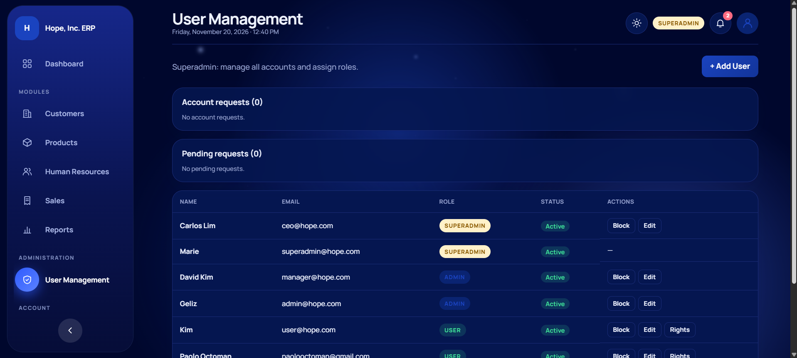
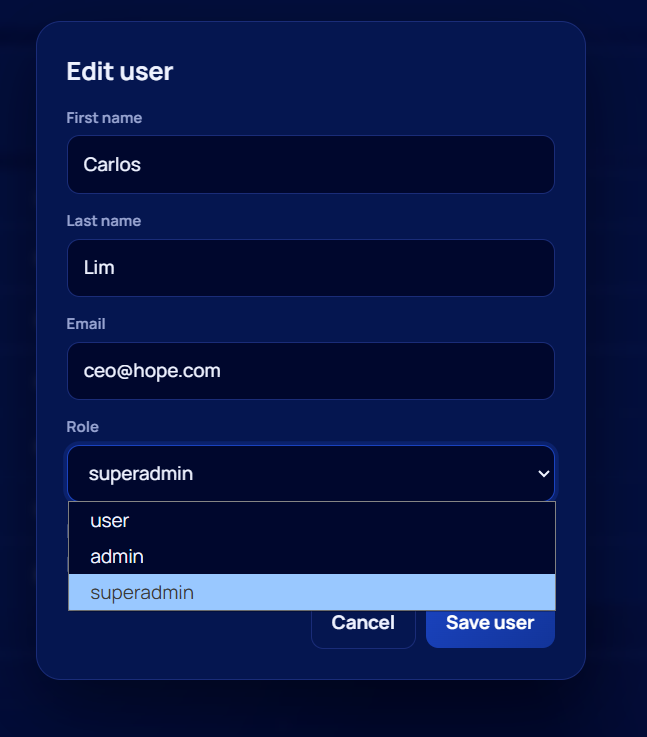
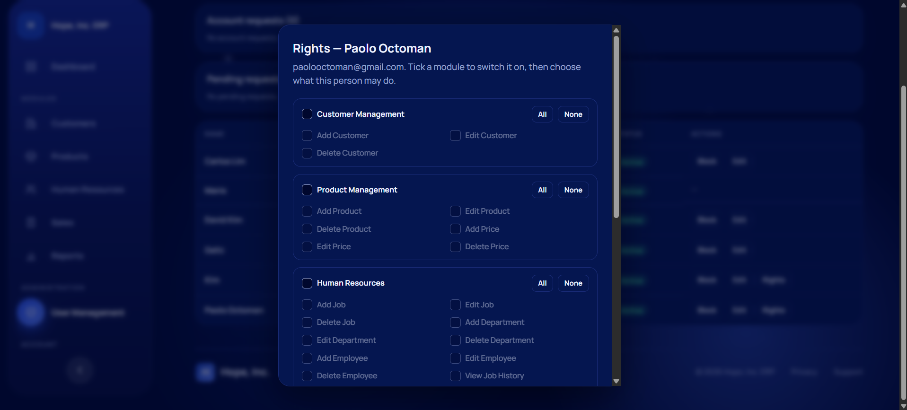

# Hope, Inc. ERP - User Management Revisions (S1-UIX-Revisions1) 

Made the design mockups for the Rights button on User Management open a Rights dialog (Figures 37–40), where an Admin or Superadmin sets per-action rights by module with a module checkbox and All/None. (An update for Sprint 1 problem)

