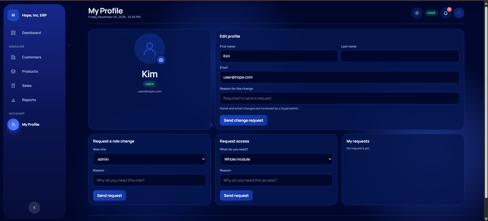
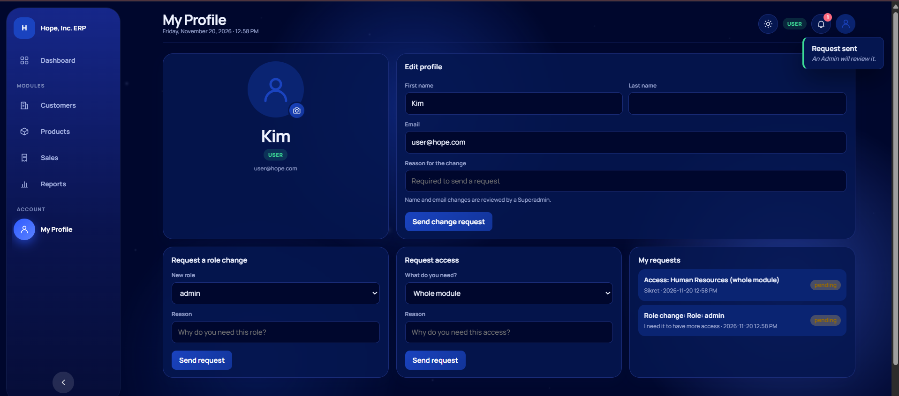

# Hope, Inc. ERP - Approving/Declining Roles and Access Revisions (S1-UIX-Revisions2) 

1. Made the design mockups for the revisions on User Management where a superadmin can approve/decline the new accounts and give them roles and rights. 
2. The Superadmin can also add now a user and approve new accounts just by using the user management module.
3. A user can now request for changes in roles and accesses through their profiles.

User view (In his/her profile) requesting for role change/access:

SuperAdmin view (In user management module):

