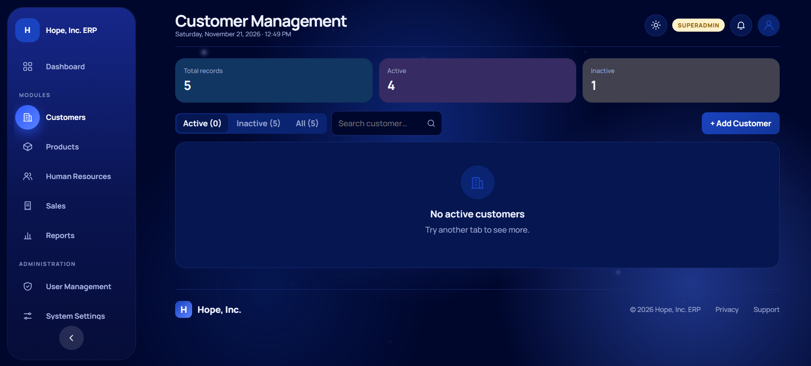
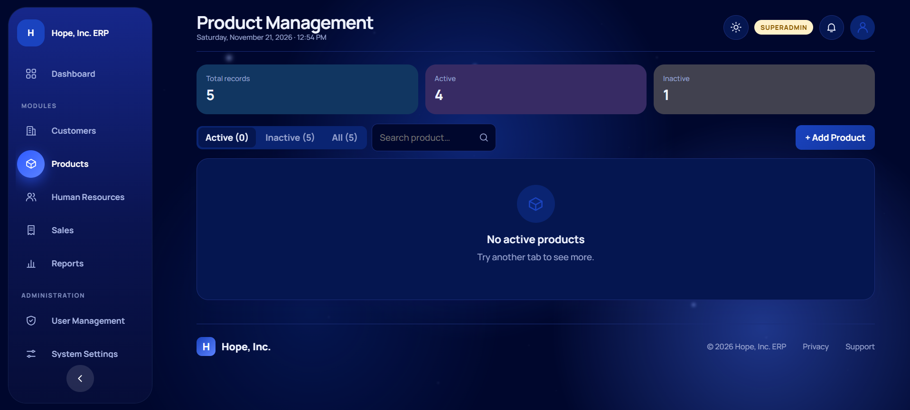
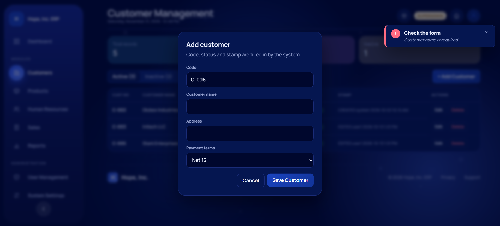
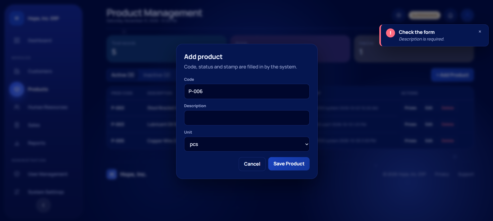
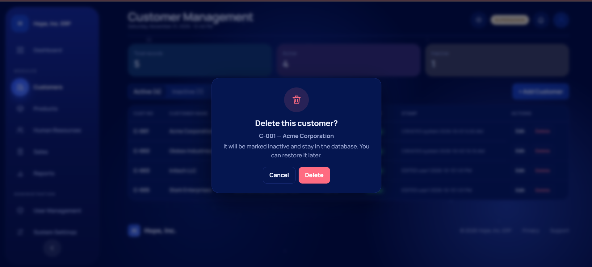
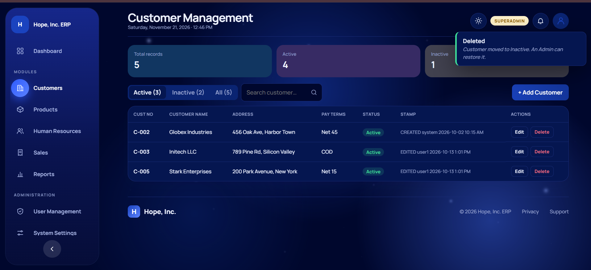
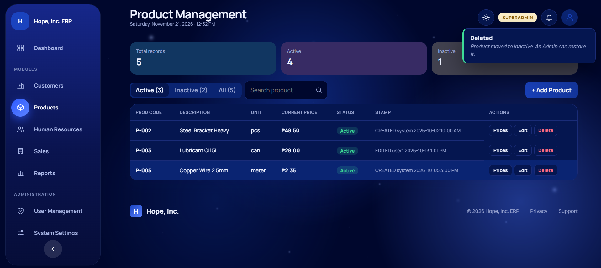

# Hope, Inc. ERP - Hi-fi Mockups (S2-UIX-04)

This document contains the design of the empty, error, and confirm-delete states for the Sprint 2 screens.

1. An empty state (no customers or products yet) and a no-search-results state

CUSTOMERS MODULE

PRODUCTS MODULE

2. Error messages for a failed save

CUSTOMERS MODULE

PRODUCTS MODULE

3. A confirm-delete dialog

CUSTOMERS MODULE

PRODUCTS MODULE

4. Link to the design: https://drive.google.com/file/d/1LAIIdWvKRnRk8gvjQxrsfCSwcG5SGBsz/view?usp=sharing 